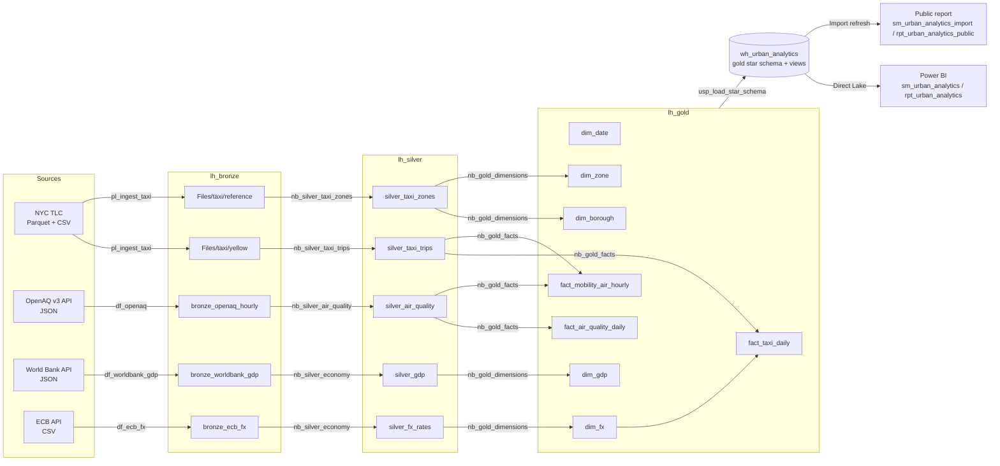

# Data Lineage

`rpt_urban_analytics_public` is a clone of the main report bound to an Import-mode copy of the model, because
Publish to web does not accept Direct Lake models (`07_analytics/08_nb_public_model.py`).

## Orchestration
`pl_master` (daily 03:00 UTC+05:00, schedule configured; switched off while the capacity is paused) runs every arrow above in dependency order — see `06_orchestration/02_orchestration_guide.md`.

## Purview lineage
Fabric captures item-level lineage automatically. Open the workspace → **Lineage view** to see
pipelines → lakehouses → notebooks → warehouse → semantic model → report. With Microsoft Purview
connected to the tenant, the same graph appears in the Purview Data Map / Unified Catalog.
