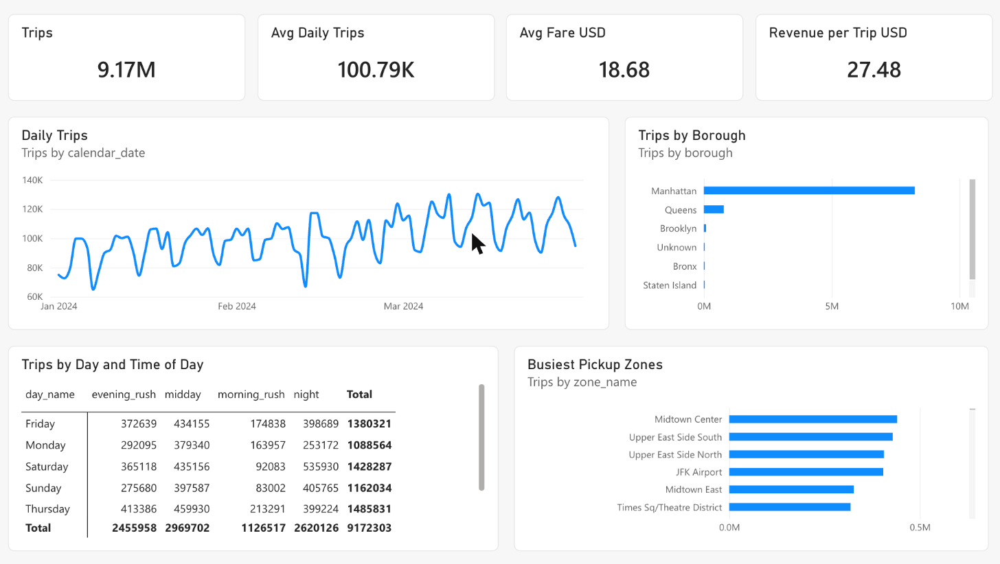
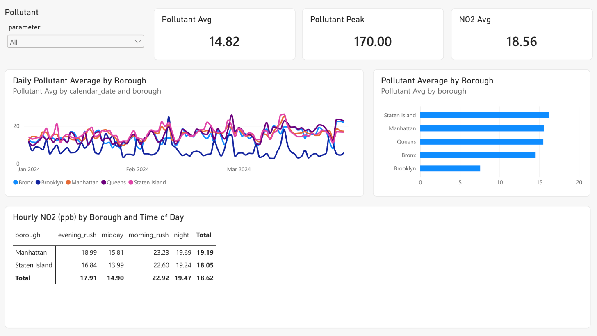
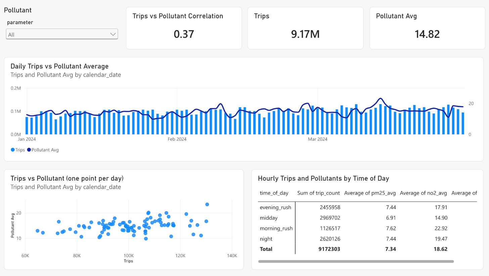
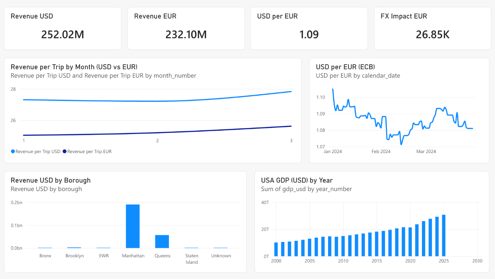

# Urban Mobility, Air Quality & Economy — Microsoft Fabric

Unified analytics platform on Microsoft Fabric combining **NYC Taxi** (mobility), **OpenAQ** (air quality),
**World Bank GDP** and **ECB USD/EUR FX** (economy) using a medallion architecture.

```
Sources ──► Bronze (lh_bronze) ──► Silver (lh_silver) ──► Gold (lh_gold) ──► Warehouse (star schema) ──► Power BI
          Pipeline + Dataflow Gen2     PySpark notebooks      PySpark notebooks     T-SQL procedures/views      Direct Lake
```

## Power BI report (`rpt_urban_analytics`)
**Live public report:** https://app.fabric.microsoft.com/view?r=eyJrIjoiMWI0MzI3NjQtYjkwOC00NWIxLWEzNDAtYWFiZWY0ZjVlODljIiwidCI6ImNkNjgxMGVmLWFiYzYtNGZjMS1hYjA1LWNmYzhhMTliNzJjNSIsImMiOjEwfQ%3D%3D

Direct Lake report on the warehouse star schema, built by `07_analytics/07_nb_report_builder.py`.
The public link serves `rpt_urban_analytics_public` — a clone bound to an Import-mode copy of the model
(`07_analytics/08_nb_public_model.py`), because Publish to web does not support Direct Lake.

| Mobility | Air Quality |
|---|---|
|  |  |
| **Mobility vs Air** | **Economic Impact** |
|  |  |

Key results (Jan–Mar 2024): 9.17M trips, 100.79K trips per day, revenue per trip $27.48,
daily trips vs pollutant correlation 0.37, revenue $252.02M = €232.10M (FX impact €26.85K).

## Analytical questions → where answered
| Question | Answer |
|---|---|
| Trips per day vs PM2.5/NO2 | `gold.vw_MobilityAirCorrelation` (`daily_city`), *Mobility vs Air* page |
| Strongest zone / time-of-day link | `gold.vw_MobilityAirCorrelation` (`hourly_borough`), `nb_insights` |
| Revenue per trip USD vs EUR, FX effect | `gold.vw_MonthlyRevenueUsdEur`, `[FX Impact EUR]` |
| Growth vs environment over years | `gold.vw_YearlyMobilityEconomyEnvironment` |

## Qayerdan boshlash
1. **`00_STEP_BY_STEP.md`** — 0 dan oxirigacha yagona yo'l xaritasi (fayl yozish tartibi + Fabric qadamlari + tekshiruvlar).
2. **`08_docs/04_project_overview.md`** — loyiha maqsadi, kutilgan natijalar, himoya uchun cheklovlar.

## Project structure
```
data_coursework/
├── README.md
├── 00_STEP_BY_STEP.md                   full walkthrough with checkpoints
├── 01_setup/                            workspace, items, connections
├── 02_bronze/                           pl_ingest_taxi (JSON) + 3 Dataflow Gen2 (M)
├── 03_silver/                           nb_config, nb_common, 4 silver notebooks
├── 04_gold/                             gold dimensions and facts notebooks
├── 05_warehouse/                        star schema, loader procedures, analytics views, security
├── 06_orchestration/                    pl_master (JSON) + schedule
├── 07_analytics/                        nb_insights, Power BI measures, report layout, RLS
├── 08_docs/                             data dictionary, lineage, governance, project overview
├── 09_notebooks_ipynb/                  generated .ipynb files for Fabric import
└── 10_tools/                            py_to_ipynb converter, local smoke test, requirements
```

## Code conventions
- Shared constants in `nb_config`, shared helpers in `nb_common`; every notebook reuses them via `%run`.
- Small single-purpose functions with descriptive names; no comments in code.
- Each `# %%` line in a `.py` file marks a new notebook cell.
- One generic warehouse loader (`gold.usp_reload_table`) instead of one procedure per table.

## Deliverables checklist
- [x] Lakehouses Bronze / Silver / Gold with three source domains
- [x] Pipelines (`pl_ingest_taxi`, `pl_master`) and Dataflows Gen2 (`df_openaq`, `df_worldbank_gdp`, `df_ecb_fx`)
- [x] Warehouse star schema + analytics views
- [x] Visualizations: `nb_insights` + 4-page Power BI report (`nb_semantic_model`, `nb_report_builder`)
- [x] Governance: RLS, refresh schedule, lineage, data quality, documentation (`08_docs`)
